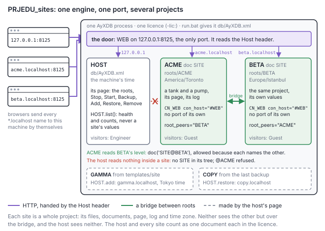

# PRJEDU_sites — several projects in one engine

One engine process, one port, three projects: a **host** and two sites, **ACME** and
**BETA**. Each site is a complete project of its own — its files, its documents, its
page, its log, its time zone — and neither can see the other, or be seen by the host.

```bat
run.bat
```

On Linux: `./run.sh`.

Then open **http://127.0.0.1:8125/**, the host's page, and from it the two sites:
**http://acme.localhost:8125/** and **http://beta.localhost:8125/**. The same port, three
names: the door reads the `Host` header and hands the request to the project whose name it
is. Chrome, Edge and Firefox send every `*.localhost` name to this machine by themselves;
from a command line, give the name in the header:

```bat
curl -H "Host: acme.localhost:8125" http://127.0.0.1:8125/state.ayp
```

| | the host | ACME, BETA |
|---|---|---|
| root file | `db/AyXDB.xml`, the file `run.bat` gives the engine | `roots/ACME/db/AyXDB.xml`, `roots/BETA/db/AyXDB.xml` |
| `%PRJ%` | this directory | `roots/ACME`, `roots/BETA` |
| its page | `www/` (the roots, buttons) | `roots/<name>/www/` (a tank and a pump) |
| its log | `log/HOST-*.log` | `roots/<name>/log/SITE-*.log` |
| time zone | the machine's | ACME `America/Toronto`, BETA `Europe/Istanbul` |
| listens on | **8125**, the only port | nothing: it takes what the door hands it |

`templates/site` is a third copy of the same project that nothing loads: the host's page
makes new sites from it.



The same drawing is at the bottom of the example's page.

## The host's page

**The roots**, from `HOST.list()`: running or not, the worst health level, how many
documents, connections, threads and sessions, FAIL and PANIC lines in its logs. A summary —
the host never sees a site's values.

| Button | Calls | What you see |
|---|---|---|
| **Stop** | `HOST.stop('ACME')` | ACME's page says *stopped by the host* (the door answers 503). BETA's goes on |
| **Start** | `HOST.start('ACME')` | ACME's page goes on, its tank where it was |
| **Backup** | `HOST.backup('ACME')` | a copy in `backup/ACME-<time>/`: the site's directory and the host's settings of it. ACME is suspended for the copy (about a third of a second) |
| **Add GAMMA from the template** | `HOST.add('GAMMA', '%PRJ%/templates/site', {root_host: 'gamma.localhost'})` | `templates/site` copied to `roots/GAMMA`, a `<doc id="GAMMA">` line appended to `db/AyXDB.xml`, loaded and started. http://gamma.localhost:8125/ answers, in Tokyo time |
| **Restore the last backup as COPY** | `HOST.restore('COPY', <backup>, {root_host: 'copy.localhost'})` | a second site made from the backup, at http://copy.localhost:8125/ |
| **Remove with its data** | `HOST.remove('GAMMA', 1)` | GAMMA stopped, its line taken out of `db/AyXDB.xml`, `roots/GAMMA` deleted. Only for GAMMA and COPY: the page does not delete the example's own sites |

`add`, `remove`, `backup` and `restore` run in the background, one at a time; the call
answers at once and the host's log says when each ended. A call that cannot do what it is
asked throws, and its reason goes on the page:

```
HOST.restore: refused -- the process has a document or root 'COPY'
```

**What the host gets from inside a site.** Every site has a document called `SITE` with a
`LEVEL` in it:

| From the host | Answer |
|---|---|
| `doc('SITE')/id('LEVEL')/@val` | nothing: no `SITE` in the host's tree |
| `doc('*')/id('LEVEL')/@val` | `[{"doc":"HOST","val":""}]`: the star stops at the roots |
| `doc('SITE@ACME')/id('LEVEL')/@val` | nothing, and one line in the host's log: `bridge refused -- root 'ACME' does not list 'HOST' in its root_peers` |

## A site's page

The same page in every site, served from that site's own `www/`:

- **The tank** fills by itself and a pump empties it between two levels. The slider writes
  where the pump starts — to this site only: open the other site's page beside it.
- **This root's clock**: `Time.GetTimeStr()` and the shift worked out from it, in the site's own
  `xdb_tz`. One process, three local times. Each log file is stamped and named in its own zone too.
- **Over the bridge**: the other site's level, read with `doc('SITE@BETA')`, the way a document on
  another engine is read ([10_Two_Engines](../../../docs/10_Two_Engines.md)) — with no network under
  it. It works only because each site's root file names the other in `root_peers`.
- **What this root sees**: `doc('*')` finds its own `SITE` and nothing else; `doc('HOST')` is not
  there; `HOST.list()` throws `HOST.* is the host's`. **Your role here** is 0, a Guest: the host's
  door gives its own visitors Engineer (`con_role="6"`), but a request handed to a site is judged by
  the site's connection, which gives none.

GAMMA and COPY name no peer that names them: their bridge row says *nothing came back*, and their
log says why: `bridge refused -- root 'ACME' does not list 'GAMMA' in its root_peers`.

## How it is put together

**The process root** turns it on and lists the sites, one `<doc>` each:

```xml
<xdb id="HOST" ... xdb_roots="project">
  <config>
    <script id="main" ... src="%DB%/db_HOST.js"/>
    <doc id="ACME" xdb_root="1" root_host="acme.localhost" src="%PRJ%/roots/ACME/db/AyXDB.xml" desc="a site in Toronto"/>
    <doc id="BETA" xdb_root="1" root_host="beta.localhost" src="%PRJ%/roots/BETA/db/AyXDB.xml" desc="a site in Istanbul"/>
  </config>
  <data>
    <con id="WEB" xdb_fnc="[CON.tcp,PRO.http]" con_host="127.0.0.1" con_port="8125" con_mod="SERVER"
         con_acl="127.0.0.1" con_role="6" pro_http_root="%PRJ%/www" .../>
  </data>
</xdb>
```

Everything on a site's `<doc>` is the **host's** word: `root_host` (the names the door hands
it), `desc`. A site that wrote them in its own file would be told they are ignored.

**A site** is an ordinary project root. Its page connection listens on no port of its own: it
takes what the host's door hands it.

```xml
<xdb id="SITE" ... tid="ACM" xdb_tz="America/Toronto" root_peers="BETA">
  ...
  <con id="CN_WEB" xdb_fnc="[CON.tcp,PRO.http]" con_host="#WEB" con_port="" con_mod="SERVER"
       pro_http_root="%PRJ%/www" .../>
```

`con_host="#WEB"` names the door, `con_port=""` takes every path. A site could have more
takers on the same door, each with its own path (`con_port="/api"`); the longest one that
starts the path wins.

**The pages** are `state.ayp`, a [server page](../../web/PRJEDU_pages/) the engine runs with the
visitor's role on every request: it calls the document's script and answers JSON. `index.html`
asks it once a second and posts the buttons and the slider to it.

**The host's script** (`db/db_HOST.js`) and **a site's** (`db_SITE.js`, the same file in every
site) are short; the comments say the rest.

## What it measured

On a Windows 11 laptop, the engine in `bin` (4.4.3.769):

| | |
|---|---|
| the process, host and two sites | 18 MB working set; 20.5 MB with GAMMA and COPY too |
| `HOST.add('GAMMA', ..)` until GAMMA runs | 12 to 44 ms |
| `HOST.restore('COPY', ..)` until COPY runs | 42 to 55 ms |
| `HOST.backup` | the site suspended for 345 to 380 ms (54 to 77 KB, 9 to 11 files) |
| `HOST.remove(.., 1)`, directory gone | 100 to 140 ms |
| Add, then Remove | `db/AyXDB.xml` byte for byte as before |
| Stop, then Start | the page back in 23 cycles of 25. The two misses were in one run of five: there Start left the site's page connection down (the door kept answering 503) while the site itself ran on — an engine fault this example found, fixed in 4.4.3.770 (on 769, stop and start the engine to get the page back) |
| CTRL-C | exit 0, 0.2 to 0.5 s; GAMMA, if added, comes back at the next start |
| Linux (WSL, Ubuntu 22.04), `run.sh` | the three names answer, GAMMA added and removed, SIGINT exit 0 |

## Try this

Each row was tried on a copy of the project, on the same engine.

| Do | See |
|---|---|
| Stop ACME, watch BETA's page | BETA still reads ACME's level over the bridge, and it stands still: a stopped site keeps its values; a bridge is not a connection |
| Backup BETA, then Restore | COPY is BETA again — its time zone, its `tid` — but its bridge to ACME is refused: ACME names BETA, not COPY |
| Add GAMMA, stop the engine, `run.bat` again | GAMMA is still there: `HOST.add` wrote it into `db/AyXDB.xml`. Remove it to go back |
| Three more `<doc xdb_root="1">` lines in `db/AyXDB.xml` (copies of `templates/site`) | the fifth document is not loaded: `'C3' NOT LOADED -- licence allows 5 document(s)` (below) |
| `xdb_roots="tenant"` in `db/AyXDB.xml` | the mode for sites of different customers. The pages answer 404: in a tenant process a site may make only what the host allows, and `PRO.http` needs `root_cap="http"` on its `<doc>`. The bridge is refused (`a tenant process has no bridge between roots`), and Add GAMMA is refused by the licence (`feature 'tenant' ... loads 2 root(s)`) |
| then `root_cap="http"` on both `<doc>` lines | the pages answer again |

## Licence

One licence for the whole process (`-lic:`), and the sites count against it like one project:
the host and every site are one document each, so **5 documents** in the education licence hold
the host, ACME, BETA, GAMMA and COPY — and no more. One connection each, five of eight. A project
process is not limited by the number of sites; a tenant process is (feature `tenant`: 2 sites
without it).

More in [15_Many_Projects_One_Engine](../../../docs/15_Many_Projects_One_Engine.md).
